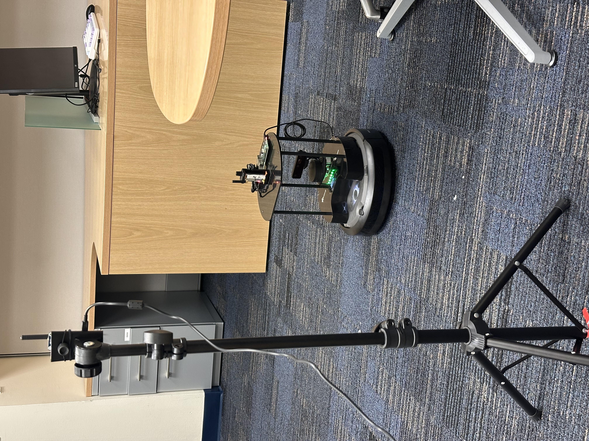
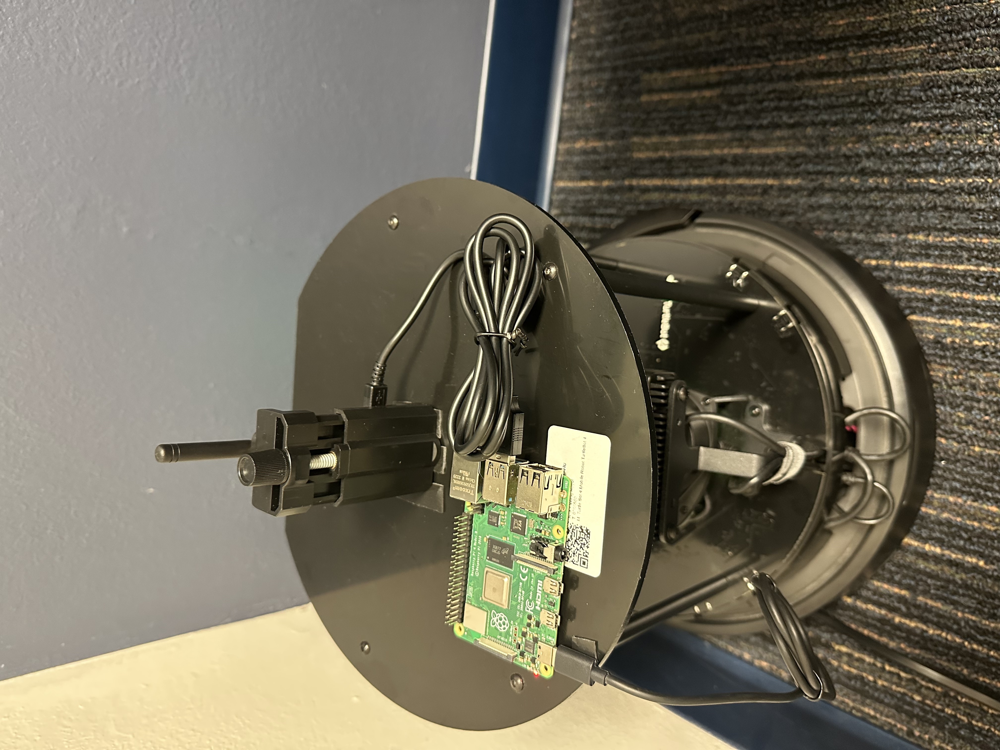
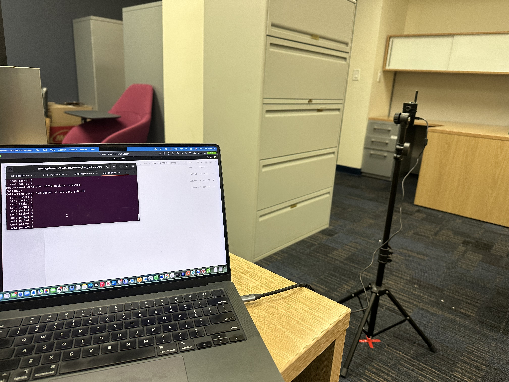

# Indoor LoRa RSSI Radio-Map Testbed with TurtleBot4

End-to-end hardware and software framework for collecting spatially indexed indoor LoRa (915 MHz) Received Signal Strength Indicator (RSSI) measurements using a **Clearpath TurtleBot4** mobile robot for ROS 2 localization, two **Waveshare SX1262 915M UART LoRa HAT** transceivers (one stationary transmitter and one mobile receiver), an auxiliary **Raspberry Pi 4B** receiver node, and a virtualized **Ubuntu 24.04 LTS (ROS 2 Jazzy)** control workstation.

---

## Testbed Overview and Hardware Components

The measurement system pairs LiDAR-based indoor robot localization (`AMCL` on ROS 2 Jazzy) with synchronized sub-GHz LoRa packet bursts to build repeatable indoor radio maps:

1. **Stationary LoRa Transmitter Node**: A Waveshare SX1262 915 MHz LoRa HAT mounted on a tripod at known 3D coordinates `(x, y, z)` in the indoor map frame and connected via USB-to-UART directly to the control VM.
2. **Mobile TurtleBot4 + Auxiliary Raspberry Pi Receiver Node**: A TurtleBot4 mobile platform providing 2D LiDAR / odometry pose estimates (`/amcl_pose` and `/odom`), carrying an auxiliary Raspberry Pi 4B on its top plate connected via USB to the second SX1262 915 MHz LoRa HAT configured in packet-RSSI mode.
3. **Virtualized ROS 2 Jazzy Control Workstation**: An Ubuntu 24.04 ARM64 Linux virtual machine running on the host computer (tested in **Parallels Desktop** and **UTM** on Apple Silicon Macs), bridged onto the shared Wi-Fi network to subscribe to TurtleBot4 ROS 2 topics, trigger LoRa packet bursts over USB serial, and query received RSSI records over HTTP from the Raspberry Pi.

| Indoor Testbed Deployment | Mobile Receiver Payload (TurtleBot4 Top Plate) | Live Collection from Control VM |
| :---: | :---: | :---: |
|  |  |  |
| **Tripod-mounted SX1262 LoRa transmitter (foreground) and TurtleBot4 mobile receiver platform (background).** | **Auxiliary Raspberry Pi 4B and clamped SX1262 915 MHz receiver HAT mounted atop the TurtleBot4.** | **Host laptop running the Ubuntu 24.04 ROS 2 Jazzy VM (`collect_radiomap.py`) with USB passthrough to the transmitter HAT.** |


## End-to-End System Setup

### 1. TurtleBot4 Setup and Indoor Map Generation

Set up the TurtleBot4 robot on **ROS 2 Jazzy** (Ubuntu 24.04) and connect it to your local Wi-Fi infrastructure by following the official Clearpath Robotics documentation:

1. **Initial Robot Bringup & Wi-Fi Connection**: Follow the [TurtleBot 4 Basic Setup Guide](https://turtlebot.github.io/turtlebot4-user-manual/setup/basic.html) to power on the robot, connect to its onboarding access point, and join your lab Wi-Fi network using `turtlebot4-setup`.
2. **ROS 2 Networking Configuration**: Configure either Simple Discovery or Fast DDS Discovery Server according to the [TurtleBot 4 Networking & Discovery Server Guide](https://turtlebot.github.io/turtlebot4-user-manual/setup/discovery_server.html) so that your control workstation and the TurtleBot4 share the same Wi-Fi subnet and matching `ROS_DOMAIN_ID` / `RMW_IMPLEMENTATION`.
3. **Indoor Occupancy Grid Map**: Before collecting RSSI measurements, generate and save a 2D map (`.yaml` and `.pgm`) of your indoor test environment using SLAM by following the [TurtleBot 4 Map Generation Tutorial](https://turtlebot.github.io/turtlebot4-user-manual/tutorials/generate_map.html).

---

### 2. Control Environment Setup (ROS 2 Jazzy Workstation)

You can set up the Linux control workstation using **either** a manual installation or the pre-built virtual machine image provided with this repository:

#### Option A: Manual Setup from Official Documentation
Install **Ubuntu 24.04 LTS (Noble Numbat)**, **ROS 2 Jazzy**, and the TurtleBot4 desktop/navigation packages (`ros-jazzy-turtlebot4-desktop`, `ros-jazzy-turtlebot4-navigation`) on a native Linux PC or custom VM following the User PC instructions in the [TurtleBot 4 Software Overview](https://turtlebot.github.io/turtlebot4-user-manual/software/overview.html) and [Basic Setup Guide](https://turtlebot.github.io/turtlebot4-user-manual/setup/basic.html). Then clone this repository and install the VM Python dependencies:

```bash
source /opt/ros/jazzy/setup.bash
cd turtlebot4_lora_radiomap/vm
python3 -m pip install -r requirements.txt
```

#### Option B: Pre-Configured Virtual Machine Image (`/VM`) — Recommended
Instead of configuring Ubuntu 24.04 and ROS 2 Jazzy from scratch, you can import the ready-to-use virtual machine image documented in **[`VM/README.md`](VM/README.md)**. This image already includes Ubuntu 24.04 LTS (ARM64), ROS 2 Jazzy, TurtleBot4 navigation and visualization packages, indoor map files, and the `turtlebot4_lora_radiomap` scripts.

- **Download Links & Import Steps**: Download the pre-configured VM image from **[GitHub Releases (`v1.0.0`)](https://github.com/luis-lago/lora-rssi-radiomap-comprehensive/releases/tag/v1.0.0)** and follow **[`VM/README.md`](VM/README.md)** to import either the **Parallels Desktop** bundle (`Ubuntu-Linux-24-TBL4-Jazzy.pvm`) or the **UTM / QEMU** virtual disk (`utm-disk.qcow2`).
- **Tested Hypervisors**: Verified on **Apple Silicon (M-series) Mac** hosts using both **Parallels Desktop** and **UTM**.
- **Required Host-to-Hypervisor Network Configuration (Bridged Wi-Fi)**:
  1. Connect your host computer to the **same Wi-Fi network (SSID/subnet)** to which the TurtleBot4 and the auxiliary Raspberry Pi are connected.
  2. Configure the VM network adapter in **Bridged Mode** bound to the host Wi-Fi interface (rather than NAT / Shared Networking) so the guest OS obtains an IP address directly on the lab Wi-Fi subnet and supports bidirectional ROS 2 DDS traffic.
  3. If your TurtleBot4 uses **Discovery Server** networking in ROS 2 Jazzy, verify that `ROS_DISCOVERY_SERVER` and the static route (`ip_route.service`) inside the VM point to your TurtleBot4's current Wi-Fi IP address as detailed in the [Discovery Server Guide](https://turtlebot.github.io/turtlebot4-user-manual/setup/discovery_server.html).
- **USB Passthrough for Transmitter LoRa HAT**: Plug the stationary SX1262 LoRa transmitter HAT into a host USB port and attach/pass the USB-to-UART device directly through to the running Linux VM so it enumerates inside the VM as `/dev/ttyUSB0`.

---

### 3. SX1262 LoRa HATs and Auxiliary Raspberry Pi Receiver Setup

Both transceivers are [Waveshare SX1262 915M LoRa HAT](https://www.waveshare.com/wiki/SX1262_915M_LoRa_HAT) modules operated over USB-to-UART (selector jumper set to **`A`**) with 915 MHz antennas attached prior to powering on.

#### 3.1 Program Transmitter and Receiver Registers
1. Place each HAT into **Configuration Mode** by setting its mode jumpers to:
   - **`M0` = SHORTED (Low)**
   - **`M1` = OPEN (High)**
2. Install `pyserial` (`python3 -m pip install -r turtlebot4_lora_radiomap/lora/requirements.txt`) and program each module (channel 65 at 915 MHz, 9600 bps UART, 2.4 kbps air data rate, 13 dBm TX power, 58-byte payload, and appended RSSI byte enabled on the receiver):
   ```bash
   # On the VM (with transmitter HAT connected via USB passthrough):
   cd turtlebot4_lora_radiomap/lora
   python3 configure_lora.py --port /dev/ttyUSB0 --role transmitter

   # On the auxiliary Raspberry Pi (with receiver HAT connected via USB-A):
   cd turtlebot4_lora_radiomap/lora
   python3 configure_lora.py --port /dev/ttyUSB0 --role receiver
   ```
3. Return **both** HATs to **Normal Transparent Mode** before testing or collecting data:
   - **`M0` = SHORTED (Low)**
   - **`M1` = SHORTED (Low)**

#### 3.2 Verify the Radio Link and Configure the Pi Receiver
Mount the auxiliary Raspberry Pi 4B and receiver LoRa HAT on top of the TurtleBot4, ensuring the Raspberry Pi is connected to the same Wi-Fi network as the TurtleBot4 and host computer. Full step-by-step wiring, serial group (`dialout`) permissions, and diagnostic checks are provided in [`turtlebot4_lora_radiomap/pi/raspberry_pi_lora_receiver_setup.md`](turtlebot4_lora_radiomap/pi/raspberry_pi_lora_receiver_setup.md).

Verify `turtlebot4_lora_radiomap/pi/config.json` on the Raspberry Pi:
```json
{
  "serial_port": "/dev/ttyUSB0",
  "baud_rate": 9600,
  "http_host": "0.0.0.0",
  "http_port": 8080,
  "output_csv": "receiver_packets.csv"
}
```

Check the Raspberry Pi's IP address (`hostname -I`) or mDNS hostname (`raspberrypi.local`), and update `receiver_pi_url` in `turtlebot4_lora_radiomap/vm/config.json` inside the VM to match (`"http://<PI_IP>:8080"`).

---

## Running Live LoRa RSSI Data Collection

Once the TurtleBot4, auxiliary Raspberry Pi, stationary LoRa transmitter, and bridged ROS 2 Jazzy VM are powered on and connected to the common Wi-Fi network, run a measurement campaign using four terminals from the VM:

### Pre-Flight Checklist
- Measure and record the stationary LoRa transmitter's `(x, y, z)` coordinates (in meters) within your indoor ROS map frame.
- Confirm both SX1262 LoRa HATs have antennas attached and jumpers set to Normal Mode (`UART = A`, `M0 = SHORTED`, `M1 = SHORTED`).
- Confirm the transmitter USB-to-UART cable is passed through to the Linux VM (`/dev/ttyUSB0`).
- Confirm ROS 2 communication with the TurtleBot4 (for example, `ssh ubuntu@<TURTLEBOT4_IP>` or `ros2 topic list`).

### Step 1 — Start the LoRa Receiver HTTP Server on the Raspberry Pi (Terminal 1)
From a terminal inside the VM (or host), SSH into the auxiliary Raspberry Pi mounted on top of the TurtleBot4 and launch `receiver_server.py`:

```bash
ssh <pi_user>@raspberrypi.local
cd ~/turtlebot4_lora_radiomap/pi
python3 receiver_server.py
```

Keep this terminal open. You can confirm readiness from the VM with:
```bash
curl http://<PI_IP>:8080/health
```

### Step 2 — Launch TurtleBot4 Map Localization (Terminal 2 in VM)
Open a second terminal in the ROS 2 Jazzy VM, source ROS 2, and launch AMCL localization pointing to your saved indoor map YAML file (for example, `/home/aiotlab/Desktop/maps/lab_052125.yaml` in the provided VM image):

```bash
source /opt/ros/jazzy/setup.bash
ros2 launch turtlebot4_navigation localization.launch.py map:=/home/aiotlab/Desktop/maps/lab_052125.yaml
```

### Step 3 — Launch RViz2 and Initialize Robot Pose (Terminal 3 in VM)
Open a third terminal in the ROS 2 Jazzy VM and launch the TurtleBot4 navigation visualizer:

```bash
source /opt/ros/jazzy/setup.bash
ros2 launch turtlebot4_viz view_navigation.launch.py
```

In RViz2:
1. Click **2D Pose Estimate** in the top toolbar.
2. Click on the robot's physical starting location on the map and drag in the direction the TurtleBot4 is facing so AMCL converges on the true pose (see the [TurtleBot 4 Navigation Tutorial](https://turtlebot.github.io/turtlebot4-user-manual/tutorials/navigation.html)).
3. Optionally verify that `/amcl_pose` and `/odom` are publishing (`ros2 topic echo /amcl_pose --once`).

### Step 4 — Run the Interactive Radio-Map Collector (Terminal 4 in VM)
Open a fourth terminal in the ROS 2 Jazzy VM, navigate to `turtlebot4_lora_radiomap/vm`, and start `collect_radiomap.py`:

```bash
source /opt/ros/jazzy/setup.bash
cd ~/Desktop/turtlebot4_lora_radiomap/vm   # or <repo_root>/turtlebot4_lora_radiomap/vm
python3 collect_radiomap.py
```

1. **Enter Transmitter Coordinates**: At startup, enter the number of transmitters, a unique ID (such as `tx01`), and the `x`, `y`, and `z` coordinates (in meters) measured in advance.
2. **Collect Measurements Across the Indoor Space**:
   - Drive the TurtleBot4 (via teleop, controller, or Nav2 goal) to a measurement point and **bring the robot to a complete stop**. `collect_radiomap.py` checks `/odom` and cancels capture if linear velocity exceeds `0.02 m/s` or angular velocity exceeds `0.03 rad/s`.
   - Press **`Enter`** at the `radiomap>` prompt to transmit a burst of 15 packets (58 bytes each at 5 Hz), wait `0.3 s`, retrieve the per-packet RSSI values from the Raspberry Pi server, and append synchronized records to disk.
   - Available interactive commands at `radiomap>`:
     - `Enter` — Capture a burst at the current stationary robot pose
     - `t` — Switch active transmitter (for multi-transmitter campaigns)
     - `s` — Display count of collected positions and active transmitter coordinates
     - `q` — Finish session and close cleanly

Each run creates a timestamped folder `data/<YYYYMMDD_HHMMSS_ffffff>/` containing:
- `transmitters.json` — Transmitter IDs and 3D coordinates in the `map` frame
- `raw_packets.csv` — Individual packet RSSI (`raw_rssi`, `rssi_dbm`), receive timestamp, robot `(pose_x, pose_y, pose_yaw)`, and transmitter coordinates
- `position_measurements.csv` — Per-location summary statistics (`mean_rssi_dbm`, `median_rssi_dbm`, `std_rssi_db`, `minimum_rssi_dbm`, `maximum_rssi_dbm`, `packet_delivery_ratio`, and `valid_measurement`)

---

## Included Measurement Campaigns and Dataset Generation

- **`data/`**: Contains **8 completed indoor LoRa RSSI measurement sessions** (`20260721_*` through `20260804_*`) recorded with this testbed.
- **`create_lora_rssi_dataset.py`**: Converts valid rows across multiple session `position_measurements.csv` files into a standardized machine-learning radio-map dataset layout matching `BLE/`:

```bash
python3 create_lora_rssi_dataset.py \
  --input-glob "./data/20260*/position_measurements.csv" \
  --output-dir lora_rssi \
  --receiver-z 0.470 \
  --seed 42
```

This generates `gateway_position.yml`, `gateway_rssi.csv`, `tx_pos.csv`, `train_index.txt`, and `test_index.txt` inside `lora_rssi/`.

---

## References

- [Clearpath Robotics — TurtleBot 4 User Manual (ROS 2 Jazzy)](https://turtlebot.github.io/turtlebot4-user-manual/overview/)
- [TurtleBot 4 Basic Setup](https://turtlebot.github.io/turtlebot4-user-manual/setup/basic.html)
- [TurtleBot 4 Discovery Server & Networking](https://turtlebot.github.io/turtlebot4-user-manual/setup/discovery_server.html)
- [TurtleBot 4 SLAM & Navigation Tutorials](https://turtlebot.github.io/turtlebot4-user-manual/tutorials/navigation.html)
- [Waveshare SX1262 915M LoRa HAT Wiki](https://www.waveshare.com/wiki/SX1262_915M_LoRa_HAT)

